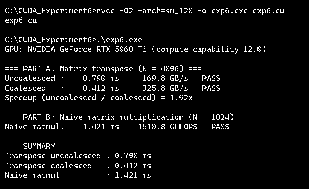

# Experiment 6: Memory Optimization in CUDA

**Lab:** Memory Systems and Synchronization  
**Topics:** Coalesced vs. uncoalesced access, matrix transpose, naive matrix multiplication  
**Language:** CUDA C/C++  
**Target GPU:** NVIDIA GeForce RTX 5060 Ti (compute capability 12.0, `sm_120`)  
**Detected CUDA Toolkit:** 13.4 (NVCC 13.4.92)  
**OS:** Windows

> **Execution status:** Successfully compiled and executed on the NVIDIA GeForce RTX 5060 Ti. All three GPU result checks reported **PASS**. The measured values below are from the captured run on **17 November 2026**. The terminal screenshot is stored at `results/execution_output.png`.

---

## 1. Aim

Study how CUDA global-memory access patterns affect GPU performance by comparing an uncoalesced and coalesced matrix transpose, running naive matrix multiplication, measuring execution time on the GPU, calculating performance metrics, and verifying results.

## 2. Learning outcomes

- Explain memory coalescing and its effect on global-memory bandwidth.
- Launch two-dimensional CUDA grids and blocks.
- Use shared memory to stage a tile and make transpose accesses coalesced.
- Explain the role of `__syncthreads()` and shared-memory padding.
- Measure GPU kernel time using CUDA events.
- Calculate effective bandwidth, GFLOPS, and speedup.
- Verify GPU results against CPU reference calculations.

## 3. Theory

### 3.1 Memory coalescing

CUDA threads execute in groups called warps. A warp contains 32 threads. When threads in a warp access nearby global-memory addresses, the GPU can combine the accesses into fewer memory transactions. This is called **coalesced access**.

When adjacent threads access addresses separated by a large stride, more memory transactions may be needed and effective bandwidth can fall.

For a row-major matrix of width \(N\), element \((r,c)\) is stored at:

\[
\operatorname{index}(r,c)=rN+c
\]

### 3.2 Matrix transpose

Transpose converts:

\[
B[j][i]=A[i][j]
\]

**Uncoalesced kernel — `transposeNaive`:** each thread reads one element from a row-contiguous input location, then writes it to a strided output location. The writes across neighbouring threads are poorly coalesced.

**Coalesced kernel — `transposeCoalesced`:**

1. Loads a 32 × 32 tile from global memory into shared memory with coalesced reads.
2. Synchronizes the block with `__syncthreads()`.
3. Swaps block coordinates.
4. Reads the shared-memory tile transposed and writes contiguous output locations.

The shared-memory tile is declared as:

```cpp
__shared__ float tile[TILE][TILE + 1];
```

The extra column is padding. It changes the shared-memory stride and helps avoid bank conflicts during transposed reads.

### 3.3 Naive matrix multiplication

For two \(N\times N\) matrices:

\[
C=A\times B
\]

Each output element is:

\[
C[i][j]=\sum_{k=0}^{N-1} A[i][k]B[k][j]
\]

In `matMulNaive`, one CUDA thread computes one element of C. It performs N iterations, reading A and B from global memory on each iteration. The kernel does not explicitly stage reusable input tiles in shared memory. A tiled matrix multiplication kernel could improve data reuse, but is outside this experiment's naive baseline.

## 4. Implementation

Source: `exp6.cu`

| Function / kernel | Role |
|---|---|
| `transposeNaive` | Baseline transpose with strided global writes |
| `transposeCoalesced` | Shared-memory tiled transpose with padding |
| `matMulNaive` | One thread computes one output element |
| `timeTranspose` | Warm-up and CUDA-event timing over repeated launches |
| `checkTranspose` | Compares every transpose element with the expected value |
| `checkMatMul` | Checks 20 output positions against a CPU reference |
| `main` | Allocates/copies memory, launches kernels, prints metrics and frees memory |

### Kernel launch configuration

- Transpose tile: `TILE = 32`; block = 32 × 32 threads.
- Matrix multiplication tile: `BLK = 16`; block = 16 × 16 threads.
- Grid dimensions are rounded up to cover the requested matrix dimensions.

### Timing configuration

- Transpose: one warm-up launch followed by 20 timed launches; the program reports average time per launch.
- Matrix multiplication: one warm-up launch followed by 5 timed launches; the program reports average time per launch.
- CUDA events measure work on the GPU and avoid relying on CPU launch timing alone.

## 5. Hardware and software

| Component | Detected value |
|---|---|
| GPU | NVIDIA GeForce RTX 5060 Ti |
| GPU memory | 16 GB (as reported by `nvidia-smi`) |
| NVIDIA driver | 610.88 |
| Driver CUDA UMD version | 13.3 |
| CUDA Toolkit | 13.4 |
| NVCC | 13.4.92 |
| Compute capability | 12.0 |
| Target architecture | `sm_120` |
| Host compiler | Microsoft MSVC C++ (`cl.exe`) required |

The installed NVCC lists `compute_120` and `sm_120` as supported targets.

## 6. Setup and execution on Windows

### 6.1 Check the NVIDIA driver and CUDA Toolkit

Run in PowerShell:

```powershell
nvidia-smi
nvcc --version
nvcc --list-gpu-arch
nvcc --list-gpu-code
```

### 6.2 Install the Microsoft C++ host compiler

If compilation reports:

```text
nvcc fatal : Cannot find compiler 'cl.exe' in PATH
```

install **Build Tools for Visual Studio** from:

https://visualstudio.microsoft.com/downloads/

In the installer, select the **Desktop development with C++** workload. Ensure these components are included:

- MSVC C++ x64/x86 build tools.
- Windows 10 or Windows 11 SDK.

### 6.3 Open a compiler-enabled terminal

After installation, open **Developer PowerShell for Visual Studio** from the Windows Start menu. Verify that MSVC is available:

```powershell
where.exe cl
cl
```

The `where.exe cl` command should return the path to `cl.exe`; the `cl` command should print the Microsoft C/C++ compiler banner.

### 6.4 Compile for the RTX 5060 Ti

Change to the cloned repository directory and compile:

```powershell
cd C:\l6-Memory-optimization-in-CUDA
nvcc -O2 -arch=sm_120 -o exp6.exe exp6.cu
```

A successful compile should return to the prompt without an NVCC fatal error and create `exp6.exe`.

### 6.5 Run the default experiment

```powershell
.\exp6.exe
```

Default matrix sizes:

| Part | Matrix size |
|---|---:|
| Transpose (both kernels) | 4096 × 4096 |
| Naive matrix multiplication | 1024 × 1024 |

Optional smaller sizes can be supplied as two command-line arguments:

```powershell
.\exp6.exe 2048 512
```

The first argument is the transpose dimension and the second is the matrix multiplication dimension.

## 7. Performance calculations

### 7.1 Effective transpose bandwidth

Each transpose reads and writes one N × N matrix of 32-bit floats:

\[
BW=\frac{2\times N\times N\times 4}{t}
\]

The program reports GB/s, using the measured average kernel time in milliseconds and the corresponding decimal unit conversion.

### 7.2 Matrix multiplication throughput

The naive matrix multiplication performs approximately \(2N^3\) floating-point operations (one multiplication and one addition for each k):

\[
GFLOPS=\frac{2N^3}{t}
\]

The program reports GFLOPS from its measured average time in milliseconds.

### 7.3 Transpose speedup

\[
\text{Speedup}=\frac{t_{uncoalesced}}{t_{coalesced}}
\]

A value greater than 1 means the coalesced transpose is faster for that run.

## 8. Results and observations

**Fill this table only after successfully running the program on the target GPU.**

| Kernel | N | Average time (ms) | Speedup | Bandwidth / throughput | Verification |
|---|---:|---:|---:|---:|---|
| Uncoalesced transpose | 4096 | **0.790** | 1.00× baseline | **169.8 GB/s** | **PASS** |
| Coalesced transpose | 4096 | **0.412** | **1.92×** | **325.8 GB/s** | **PASS** |
| Naive matrix multiplication | 1024 | **1.421** | — | **1510.8 GFLOPS** | **PASS** |

**GPU:** NVIDIA GeForce RTX 5060 Ti  
**Compute capability:** 12.0  
**Actual run date:** 17 November 2026  
**Run count represented by screenshot:** One captured execution. The lab procedure recommends at least three runs; repeat the experiment and record additional runs if your submission requires averaged observations.

### Execution screenshot

The screenshot below is the terminal output captured from the successful run:



The captured output shows both transpose kernels and naive matrix multiplication completing with **PASS** verification. The coalesced transpose measured 1.92× the speed of the uncoalesced transpose in this run.

## 9. Analysis and discussion

1. **Why should the coalesced transpose be faster?** The naive kernel's output writes are strided across threads. The tiled kernel uses shared memory to transpose the tile so both global-memory reads and writes can be contiguous.
2. **Why is `__syncthreads()` required?** Threads must finish loading the shared-memory tile before any thread reads the tile in its transposed orientation.
3. **Why use `TILE + 1` padding?** Padding changes the shared-memory row stride and helps prevent bank conflicts during column-wise access.
4. **Why might naive matrix multiplication be inefficient?** Values from A and B are loaded repeatedly from global memory rather than explicitly reused from shared-memory tiles.
5. **Why use CUDA events?** Kernel launches are asynchronous with respect to the host. CUDA events record elapsed time on the GPU timeline.
6. **Why repeat launches?** Warm-up and averaging reduce the influence of initial setup and timing variation.

**Observed in this run:** the coalesced transpose completed in 0.412 ms compared with 0.790 ms for the uncoalesced transpose, corresponding to the reported 1.92× speedup. Effective bandwidth increased from 169.8 GB/s to 325.8 GB/s. The naive 1024 × 1024 matrix multiplication reported 1.421 ms and 1510.8 GFLOPS. All three result checks passed. Performance depends on GPU architecture, driver, clocks, compiler, matrix dimensions, and system state; repeated runs are recommended to assess timing variation.

## 10. Conclusion

This experiment demonstrates that global-memory access patterns influence CUDA kernel performance. The coalesced transpose uses shared memory to reorganize accesses, while the naive matrix multiplication serves as a baseline without explicit shared-memory data reuse. The final conclusion about measured speedup and throughput must be completed after collecting actual GPU results.

## 11. Repository structure

```text
l6-Memory-optimization-in-CUDA/
├── exp6.cu
├── README.md
└── results/
    ├── README.md
    └── execution_output.png
```

## 12. References

- NVIDIA CUDA C++ Programming Guide: https://docs.nvidia.com/cuda/cuda-c-programming-guide/
- NVIDIA CUDA C++ Best Practices Guide: https://docs.nvidia.com/cuda/cuda-c-best-practices-guide/
- NVIDIA CUDA Toolkit documentation: https://docs.nvidia.com/cuda/

---

**Submission note:** Keep the source code, measured result table, and screenshot consistent. Update the pending entries only from the actual executable output.
